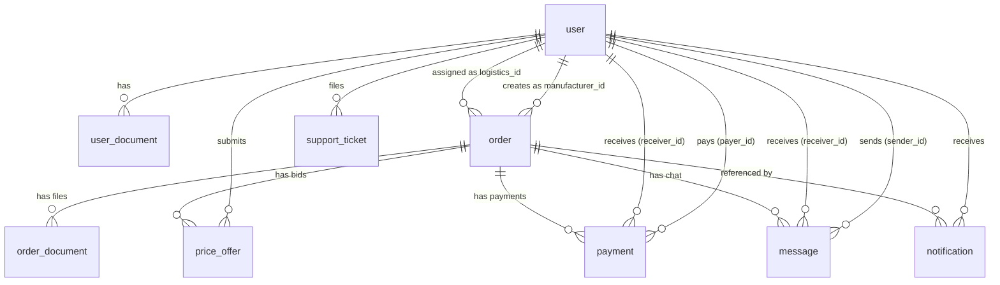

# RouteFlow — Database Map (Relational / SQLite)

> Original NoSQL design preserved in `database_map.old.md`.

---

## Overview of Changes

| What changed | Why |
|---|---|
| Each MongoDB collection → its own SQLite table | Relational normal form; explicit FK constraints |
| `User.documents` embedded array → `user_document` table | Arrays can't live in a relational column |
| `User.notificationPreferences` embedded object → columns on `user` | 5 fixed 1:1 flags with defaults; a separate table would be over-normalization |
| `Order.invoiceDocuments` / `Order.vatBillDocuments` string fields → `order_document` table | Can be multiple files; child table with `doc_type` discriminator replaces both columns |
| `PriceOffer.orderId` denormalized string → **dropped** | Derivable via `JOIN "order" ON price_offer.order_id = "order".id`; keeping it created a sync hazard |
| `Notification.orderId` plain string → `notification.order_id INTEGER FK` | Promotes loose string to a real FK; made nullable because some notifications may not reference an order |
| MongoDB ObjectId (`_id`) → `INTEGER PRIMARY KEY AUTOINCREMENT` | SQLite's native rowid-backed PK; smaller, faster joins |
| Booleans → `INTEGER` `0`/`1` with `CHECK` | SQLite has no native BOOLEAN type |
| Dates → `TEXT` ISO-8601 (`'YYYY-MM-DDTHH:MM:SS.sssZ'`) | Readable, sortable as TEXT, works with SQLite's `strftime` |

**Connection requirement:** every connection must run `PRAGMA foreign_keys = ON;` — SQLite does not enforce FK constraints without it.

---

## Table-by-Table Breakdown

### `user`

Stores all account types (logistics, manufacturer, admin).

| Column | Type | Constraints |
|---|---|---|
| `id` | INTEGER | PK AUTOINCREMENT |
| `company_name` | TEXT | NOT NULL |
| `role` | TEXT | NOT NULL DEFAULT `'logistics'` CHECK IN (`'logistics'`, `'manufacturer'`, `'admin'`) |
| `email` | TEXT | NOT NULL UNIQUE |
| `password` | TEXT | NOT NULL |
| `contact_number` | TEXT | |
| `pan_no` | TEXT | |
| `company_location` | TEXT | |
| `company_description` | TEXT | |
| `company_logo` | TEXT | |
| `company_website` | TEXT | |
| `is_verified` | INTEGER | NOT NULL DEFAULT `0` CHECK IN (`0`,`1`) |
| `is_account_verified` | INTEGER | NOT NULL DEFAULT `0` CHECK IN (`0`,`1`) |
| `submitted_for_verification` | INTEGER | NOT NULL DEFAULT `0` CHECK IN (`0`,`1`) |
| `is_active` | INTEGER | NOT NULL DEFAULT `1` CHECK IN (`0`,`1`) |
| `rejection_reason` | TEXT | |
| `otp_hash` | TEXT | |
| `otp_expires` | TEXT | ISO-8601 |
| `reset_token_hash` | TEXT | |
| `reset_token_expires` | TEXT | ISO-8601 |
| `notif_pref_email` | INTEGER | NOT NULL DEFAULT `1` CHECK IN (`0`,`1`) |
| `notif_pref_order_status` | INTEGER | NOT NULL DEFAULT `1` CHECK IN (`0`,`1`) |
| `notif_pref_bid_updates` | INTEGER | NOT NULL DEFAULT `1` CHECK IN (`0`,`1`) |
| `notif_pref_new_order_alerts` | INTEGER | NOT NULL DEFAULT `1` CHECK IN (`0`,`1`) |
| `notif_pref_chat_messages` | INTEGER | NOT NULL DEFAULT `1` CHECK IN (`0`,`1`) |
| `created_at` | TEXT | NOT NULL DEFAULT `strftime(…,'now')` |
| `updated_at` | TEXT | NOT NULL DEFAULT `strftime(…,'now')` |

**Indexes:**
```sql
CREATE INDEX idx_user_role_is_active        ON user (role, is_active);
CREATE INDEX idx_user_role                  ON user (role);
CREATE INDEX idx_user_verification          ON user (is_account_verified, submitted_for_verification);
CREATE INDEX idx_user_reset_token           ON user (reset_token_hash, reset_token_expires)
    WHERE reset_token_hash IS NOT NULL;
CREATE INDEX idx_user_otp                   ON user (otp_hash)
    WHERE otp_hash IS NOT NULL;
```

---

### `user_document`

Uploaded verification/compliance documents per user. Was an embedded subdoc array on `User`.

| Column | Type | Constraints |
|---|---|---|
| `id` | INTEGER | PK AUTOINCREMENT |
| `user_id` | INTEGER | NOT NULL FK → `user(id)` ON DELETE CASCADE |
| `type` | TEXT | NOT NULL |
| `label` | TEXT | |
| `filename` | TEXT | NOT NULL |
| `url` | TEXT | NOT NULL |
| `uploaded_at` | TEXT | NOT NULL DEFAULT `strftime(…,'now')` |

**Indexes:**
```sql
CREATE INDEX idx_user_document_user_id ON user_document (user_id);
```

---

### `order`

> ⚠️ `order` is a SQL reserved word. Always quote it as `"order"` in SQL statements.

| Column | Type | Constraints |
|---|---|---|
| `id` | INTEGER | PK AUTOINCREMENT |
| `order_id` | TEXT | NOT NULL UNIQUE — human-readable external ID (e.g. `ORD-001`) |
| `manufacturer_id` | INTEGER | NOT NULL FK → `user(id)` ON DELETE RESTRICT |
| `logistics_id` | INTEGER | FK → `user(id)` ON DELETE SET NULL — nullable until accepted |
| `product_details` | TEXT | |
| `vehicle_type` | TEXT | |
| `route_from` | TEXT | |
| `route_to` | TEXT | |
| `additional_info` | TEXT | |
| `quantity` | REAL | NOT NULL |
| `weight` | REAL | NOT NULL |
| `expected_price` | REAL | |
| `status` | TEXT | NOT NULL DEFAULT `'pending'` CHECK IN (`'pending'`,`'accepted'`,`'in transit'`,`'delivered'`,`'cancelled'`) |
| `invoice_needed` | INTEGER | NOT NULL DEFAULT `0` CHECK IN (`0`,`1`) |
| `vat_bill_needed` | INTEGER | NOT NULL DEFAULT `0` CHECK IN (`0`,`1`) |
| `created_at` | TEXT | NOT NULL DEFAULT `strftime(…,'now')` |
| `updated_at` | TEXT | NOT NULL DEFAULT `strftime(…,'now')` |

**Indexes:**
```sql
CREATE INDEX idx_order_manufacturer_id      ON "order" (manufacturer_id);
CREATE INDEX idx_order_logistics_id         ON "order" (logistics_id);
CREATE INDEX idx_order_status               ON "order" (status);
CREATE INDEX idx_order_status_logistics     ON "order" (status, logistics_id);
CREATE INDEX idx_order_created_at           ON "order" (created_at DESC);
```

---

### `order_document`

Invoice and VAT-bill files attached to an order. Replaces the two `invoiceDocuments` / `vatBillDocuments` string columns.

| Column | Type | Constraints |
|---|---|---|
| `id` | INTEGER | PK AUTOINCREMENT |
| `order_id` | INTEGER | NOT NULL FK → `"order"(id)` ON DELETE CASCADE |
| `doc_type` | TEXT | NOT NULL CHECK IN (`'invoice'`, `'vat_bill'`) |
| `url` | TEXT | NOT NULL |
| `uploaded_at` | TEXT | NOT NULL DEFAULT `strftime(…,'now')` |

**Indexes:**
```sql
CREATE INDEX idx_order_document_order_id ON order_document (order_id);
```

---

### `price_offer`

Bids submitted by logistics users on an order.

| Column | Type | Constraints |
|---|---|---|
| `id` | INTEGER | PK AUTOINCREMENT |
| `order_id` | INTEGER | NOT NULL FK → `"order"(id)` ON DELETE CASCADE |
| `logistics_id` | INTEGER | NOT NULL FK → `user(id)` ON DELETE RESTRICT |
| `proposed_price` | REAL | NOT NULL CHECK (`proposed_price >= 1`) |
| `estimated_delivery_days` | INTEGER | NOT NULL CHECK (`estimated_delivery_days >= 1`) |
| `currency` | TEXT | |
| `note` | TEXT | |
| `status` | TEXT | NOT NULL DEFAULT `'pending'` CHECK IN (`'pending'`,`'accepted'`,`'rejected'`,`'withdrawn'`) |
| `created_at` | TEXT | NOT NULL DEFAULT `strftime(…,'now')` |
| `updated_at` | TEXT | NOT NULL DEFAULT `strftime(…,'now')` |
| — | — | UNIQUE (`order_id`, `logistics_id`) — prevents duplicate bids |

**Indexes:**
```sql
-- (order_id, logistics_id) UNIQUE constraint auto-creates its index
CREATE INDEX idx_price_offer_logistics_id   ON price_offer (logistics_id);
CREATE INDEX idx_price_offer_status         ON price_offer (status);
```

---

### `payment`

Payment transaction records. Financial records — no cascade deletes.

| Column | Type | Constraints |
|---|---|---|
| `id` | INTEGER | PK AUTOINCREMENT |
| `order_id` | INTEGER | NOT NULL FK → `"order"(id)` ON DELETE RESTRICT |
| `payer_id` | INTEGER | NOT NULL FK → `user(id)` ON DELETE RESTRICT |
| `receiver_id` | INTEGER | NOT NULL FK → `user(id)` ON DELETE RESTRICT |
| `amount` | REAL | NOT NULL |
| `gateway` | TEXT | NOT NULL CHECK IN (`'khalti'`,`'esewa'`) |
| `status` | TEXT | NOT NULL DEFAULT `'pending'` CHECK IN (`'pending'`,`'completed'`,`'failed'`) |
| `pidx` | TEXT | Khalti reference |
| `ref_id` | TEXT | eSewa reference |
| `transaction_id` | TEXT | |
| `created_at` | TEXT | NOT NULL DEFAULT `strftime(…,'now')` |
| `updated_at` | TEXT | NOT NULL DEFAULT `strftime(…,'now')` |

**Indexes:**
```sql
CREATE INDEX idx_payment_order_id           ON payment (order_id);
CREATE INDEX idx_payment_payer_id           ON payment (payer_id);
CREATE INDEX idx_payment_receiver_id        ON payment (receiver_id);
```

---

### `message`

Chat messages scoped to an order between two users.

| Column | Type | Constraints |
|---|---|---|
| `id` | INTEGER | PK AUTOINCREMENT |
| `order_id` | INTEGER | NOT NULL FK → `"order"(id)` ON DELETE CASCADE |
| `sender_id` | INTEGER | NOT NULL FK → `user(id)` ON DELETE RESTRICT |
| `receiver_id` | INTEGER | NOT NULL FK → `user(id)` ON DELETE RESTRICT |
| `content` | TEXT | NOT NULL DEFAULT `''` |
| `file_url` | TEXT | |
| `file_name` | TEXT | |
| `file_type` | TEXT | CHECK IN (`'image'`,`'document'`) — NULL means no file |
| `is_read` | INTEGER | NOT NULL DEFAULT `0` CHECK IN (`0`,`1`) |
| `created_at` | TEXT | NOT NULL DEFAULT `strftime(…,'now')` |

**Indexes:**
```sql
CREATE INDEX idx_message_order_created      ON message (order_id, created_at ASC);
CREATE INDEX idx_message_receiver_is_read   ON message (receiver_id, is_read);
```

---

### `notification`

In-app notifications. `order_id` is now a proper FK (was a plain String).

| Column | Type | Constraints |
|---|---|---|
| `id` | INTEGER | PK AUTOINCREMENT |
| `recipient_id` | INTEGER | NOT NULL FK → `user(id)` ON DELETE CASCADE |
| `type` | TEXT | NOT NULL CHECK IN (`'new_bid'`,`'bid_accepted'`,`'bid_rejected'`,`'order_accepted'`,`'new_order'`,`'status_update'`) |
| `title` | TEXT | NOT NULL |
| `message` | TEXT | NOT NULL |
| `order_id` | INTEGER | FK → `"order"(id)` ON DELETE SET NULL — nullable |
| `is_read` | INTEGER | NOT NULL DEFAULT `0` CHECK IN (`0`,`1`) |
| `created_at` | TEXT | NOT NULL DEFAULT `strftime(…,'now')` |

**Indexes:**
```sql
CREATE INDEX idx_notification_recipient     ON notification (recipient_id, is_read, created_at DESC);
CREATE INDEX idx_notification_order_id      ON notification (order_id) WHERE order_id IS NOT NULL;
```

---

### `support_ticket`

User-submitted support requests.

| Column | Type | Constraints |
|---|---|---|
| `id` | INTEGER | PK AUTOINCREMENT |
| `user_id` | INTEGER | NOT NULL FK → `user(id)` ON DELETE CASCADE |
| `subject` | TEXT | NOT NULL |
| `message` | TEXT | NOT NULL |
| `category` | TEXT | NOT NULL CHECK IN (`'general'`,`'technical'`,`'billing'`) |
| `status` | TEXT | NOT NULL DEFAULT `'open'` CHECK IN (`'open'`,`'in-progress'`,`'resolved'`) |
| `admin_reply` | TEXT | |
| `replied_at` | TEXT | ISO-8601 |
| `created_at` | TEXT | NOT NULL DEFAULT `strftime(…,'now')` |
| `updated_at` | TEXT | NOT NULL DEFAULT `strftime(…,'now')` |

**Indexes:**
```sql
CREATE INDEX idx_support_ticket_user        ON support_ticket (user_id, created_at DESC);
CREATE INDEX idx_support_ticket_status      ON support_ticket (status);
CREATE INDEX idx_support_ticket_category    ON support_ticket (category);
```

---

## Relationship Summary



| Relationship | Type | FK | ON DELETE | ON UPDATE |
|---|---|---|---|---|
| `user` → `user_document` | 1:many | `user_document.user_id` | CASCADE | CASCADE |
| `user` (manufacturer) → `order` | 1:many | `order.manufacturer_id` | RESTRICT | CASCADE |
| `user` (logistics) → `order` | 1:many | `order.logistics_id` | SET NULL | CASCADE |
| `order` → `order_document` | 1:many | `order_document.order_id` | CASCADE | CASCADE |
| `order` → `price_offer` | 1:many | `price_offer.order_id` | CASCADE | CASCADE |
| `user` (logistics) → `price_offer` | 1:many | `price_offer.logistics_id` | RESTRICT | CASCADE |
| `order` → `payment` | 1:many | `payment.order_id` | RESTRICT | CASCADE |
| `user` (payer) → `payment` | 1:many | `payment.payer_id` | RESTRICT | CASCADE |
| `user` (receiver) → `payment` | 1:many | `payment.receiver_id` | RESTRICT | CASCADE |
| `order` → `message` | 1:many | `message.order_id` | CASCADE | CASCADE |
| `user` (sender) → `message` | 1:many | `message.sender_id` | RESTRICT | CASCADE |
| `user` (receiver) → `message` | 1:many | `message.receiver_id` | RESTRICT | CASCADE |
| `user` → `notification` | 1:many | `notification.recipient_id` | CASCADE | CASCADE |
| `order` → `notification` | 1:many (nullable) | `notification.order_id` | SET NULL | CASCADE |
| `user` → `support_ticket` | 1:many | `support_ticket.user_id` | CASCADE | CASCADE |

---

## Full CREATE TABLE / CREATE INDEX SQL

```sql
PRAGMA foreign_keys = ON;

-- ── user ──────────────────────────────────────────────────────────────────────
CREATE TABLE user (
  id                          INTEGER PRIMARY KEY AUTOINCREMENT,
  company_name                TEXT    NOT NULL,
  role                        TEXT    NOT NULL DEFAULT 'logistics'
                                      CHECK (role IN ('logistics', 'manufacturer', 'admin')),
  email                       TEXT    NOT NULL UNIQUE,
  password                    TEXT    NOT NULL,
  contact_number              TEXT,
  pan_no                      TEXT,
  company_location            TEXT,
  company_description         TEXT,
  company_logo                TEXT,
  company_website             TEXT,
  is_verified                 INTEGER NOT NULL DEFAULT 0  CHECK (is_verified IN (0, 1)),
  is_account_verified         INTEGER NOT NULL DEFAULT 0  CHECK (is_account_verified IN (0, 1)),
  submitted_for_verification  INTEGER NOT NULL DEFAULT 0  CHECK (submitted_for_verification IN (0, 1)),
  is_active                   INTEGER NOT NULL DEFAULT 1  CHECK (is_active IN (0, 1)),
  rejection_reason            TEXT,
  otp_hash                    TEXT,
  otp_expires                 TEXT,
  reset_token_hash            TEXT,
  reset_token_expires         TEXT,
  notif_pref_email            INTEGER NOT NULL DEFAULT 1  CHECK (notif_pref_email IN (0, 1)),
  notif_pref_order_status     INTEGER NOT NULL DEFAULT 1  CHECK (notif_pref_order_status IN (0, 1)),
  notif_pref_bid_updates      INTEGER NOT NULL DEFAULT 1  CHECK (notif_pref_bid_updates IN (0, 1)),
  notif_pref_new_order_alerts INTEGER NOT NULL DEFAULT 1  CHECK (notif_pref_new_order_alerts IN (0, 1)),
  notif_pref_chat_messages    INTEGER NOT NULL DEFAULT 1  CHECK (notif_pref_chat_messages IN (0, 1)),
  created_at                  TEXT    NOT NULL DEFAULT (strftime('%Y-%m-%dT%H:%M:%fZ', 'now')),
  updated_at                  TEXT    NOT NULL DEFAULT (strftime('%Y-%m-%dT%H:%M:%fZ', 'now'))
);

CREATE INDEX idx_user_role_is_active   ON user (role, is_active);
CREATE INDEX idx_user_role             ON user (role);
CREATE INDEX idx_user_verification     ON user (is_account_verified, submitted_for_verification);
CREATE INDEX idx_user_reset_token      ON user (reset_token_hash, reset_token_expires)
    WHERE reset_token_hash IS NOT NULL;
CREATE INDEX idx_user_otp              ON user (otp_hash)
    WHERE otp_hash IS NOT NULL;

-- ── user_document ─────────────────────────────────────────────────────────────
CREATE TABLE user_document (
  id          INTEGER PRIMARY KEY AUTOINCREMENT,
  user_id     INTEGER NOT NULL REFERENCES user(id) ON DELETE CASCADE ON UPDATE CASCADE,
  type        TEXT    NOT NULL,
  label       TEXT,
  filename    TEXT    NOT NULL,
  url         TEXT    NOT NULL,
  uploaded_at TEXT    NOT NULL DEFAULT (strftime('%Y-%m-%dT%H:%M:%fZ', 'now'))
);

CREATE INDEX idx_user_document_user_id ON user_document (user_id);

-- ── order ─────────────────────────────────────────────────────────────────────
-- NOTE: "order" is a SQL reserved word — always quote it.
CREATE TABLE "order" (
  id                  INTEGER PRIMARY KEY AUTOINCREMENT,
  order_id            TEXT    NOT NULL UNIQUE,
  manufacturer_id     INTEGER NOT NULL REFERENCES user(id) ON DELETE RESTRICT  ON UPDATE CASCADE,
  logistics_id        INTEGER          REFERENCES user(id) ON DELETE SET NULL   ON UPDATE CASCADE,
  product_details     TEXT,
  vehicle_type        TEXT,
  route_from          TEXT,
  route_to            TEXT,
  additional_info     TEXT,
  quantity            REAL    NOT NULL,
  weight              REAL    NOT NULL,
  expected_price      REAL,
  status              TEXT    NOT NULL DEFAULT 'pending'
                              CHECK (status IN ('pending', 'accepted', 'in transit', 'delivered', 'cancelled')),
  invoice_needed      INTEGER NOT NULL DEFAULT 0 CHECK (invoice_needed IN (0, 1)),
  vat_bill_needed     INTEGER NOT NULL DEFAULT 0 CHECK (vat_bill_needed IN (0, 1)),
  created_at          TEXT    NOT NULL DEFAULT (strftime('%Y-%m-%dT%H:%M:%fZ', 'now')),
  updated_at          TEXT    NOT NULL DEFAULT (strftime('%Y-%m-%dT%H:%M:%fZ', 'now'))
);

CREATE INDEX idx_order_manufacturer_id  ON "order" (manufacturer_id);
CREATE INDEX idx_order_logistics_id     ON "order" (logistics_id);
CREATE INDEX idx_order_status           ON "order" (status);
CREATE INDEX idx_order_status_logistics ON "order" (status, logistics_id);
CREATE INDEX idx_order_created_at       ON "order" (created_at DESC);

-- ── order_document ────────────────────────────────────────────────────────────
-- Replaces invoiceDocuments / vatBillDocuments string columns; supports multiple files.
CREATE TABLE order_document (
  id          INTEGER PRIMARY KEY AUTOINCREMENT,
  order_id    INTEGER NOT NULL REFERENCES "order"(id) ON DELETE CASCADE ON UPDATE CASCADE,
  doc_type    TEXT    NOT NULL CHECK (doc_type IN ('invoice', 'vat_bill')),
  url         TEXT    NOT NULL,
  uploaded_at TEXT    NOT NULL DEFAULT (strftime('%Y-%m-%dT%H:%M:%fZ', 'now'))
);

CREATE INDEX idx_order_document_order_id ON order_document (order_id);

-- ── price_offer ───────────────────────────────────────────────────────────────
CREATE TABLE price_offer (
  id                      INTEGER PRIMARY KEY AUTOINCREMENT,
  order_id                INTEGER NOT NULL REFERENCES "order"(id) ON DELETE CASCADE  ON UPDATE CASCADE,
  logistics_id            INTEGER NOT NULL REFERENCES user(id)    ON DELETE RESTRICT ON UPDATE CASCADE,
  proposed_price          REAL    NOT NULL CHECK (proposed_price >= 1),
  estimated_delivery_days INTEGER NOT NULL CHECK (estimated_delivery_days >= 1),
  currency                TEXT,
  note                    TEXT,
  status                  TEXT    NOT NULL DEFAULT 'pending'
                                  CHECK (status IN ('pending', 'accepted', 'rejected', 'withdrawn')),
  created_at              TEXT    NOT NULL DEFAULT (strftime('%Y-%m-%dT%H:%M:%fZ', 'now')),
  updated_at              TEXT    NOT NULL DEFAULT (strftime('%Y-%m-%dT%H:%M:%fZ', 'now')),
  UNIQUE (order_id, logistics_id)
);

CREATE INDEX idx_price_offer_logistics_id ON price_offer (logistics_id);
CREATE INDEX idx_price_offer_status       ON price_offer (status);

-- ── payment ───────────────────────────────────────────────────────────────────
CREATE TABLE payment (
  id              INTEGER PRIMARY KEY AUTOINCREMENT,
  order_id        INTEGER NOT NULL REFERENCES "order"(id) ON DELETE RESTRICT ON UPDATE CASCADE,
  payer_id        INTEGER NOT NULL REFERENCES user(id)    ON DELETE RESTRICT ON UPDATE CASCADE,
  receiver_id     INTEGER NOT NULL REFERENCES user(id)    ON DELETE RESTRICT ON UPDATE CASCADE,
  amount          REAL    NOT NULL,
  gateway         TEXT    NOT NULL CHECK (gateway IN ('khalti', 'esewa')),
  status          TEXT    NOT NULL DEFAULT 'pending'
                          CHECK (status IN ('pending', 'completed', 'failed')),
  pidx            TEXT,
  ref_id          TEXT,
  transaction_id  TEXT,
  created_at      TEXT    NOT NULL DEFAULT (strftime('%Y-%m-%dT%H:%M:%fZ', 'now')),
  updated_at      TEXT    NOT NULL DEFAULT (strftime('%Y-%m-%dT%H:%M:%fZ', 'now'))
);

CREATE INDEX idx_payment_order_id     ON payment (order_id);
CREATE INDEX idx_payment_payer_id     ON payment (payer_id);
CREATE INDEX idx_payment_receiver_id  ON payment (receiver_id);

-- ── message ───────────────────────────────────────────────────────────────────
CREATE TABLE message (
  id          INTEGER PRIMARY KEY AUTOINCREMENT,
  order_id    INTEGER NOT NULL REFERENCES "order"(id) ON DELETE CASCADE  ON UPDATE CASCADE,
  sender_id   INTEGER NOT NULL REFERENCES user(id)    ON DELETE RESTRICT ON UPDATE CASCADE,
  receiver_id INTEGER NOT NULL REFERENCES user(id)    ON DELETE RESTRICT ON UPDATE CASCADE,
  content     TEXT    NOT NULL DEFAULT '',
  file_url    TEXT,
  file_name   TEXT,
  file_type   TEXT    CHECK (file_type IN ('image', 'document')),
  is_read     INTEGER NOT NULL DEFAULT 0 CHECK (is_read IN (0, 1)),
  created_at  TEXT    NOT NULL DEFAULT (strftime('%Y-%m-%dT%H:%M:%fZ', 'now'))
);

CREATE INDEX idx_message_order_created    ON message (order_id, created_at ASC);
CREATE INDEX idx_message_receiver_is_read ON message (receiver_id, is_read);

-- ── notification ──────────────────────────────────────────────────────────────
CREATE TABLE notification (
  id           INTEGER PRIMARY KEY AUTOINCREMENT,
  recipient_id INTEGER NOT NULL REFERENCES user(id)    ON DELETE CASCADE  ON UPDATE CASCADE,
  type         TEXT    NOT NULL
                       CHECK (type IN ('new_bid','bid_accepted','bid_rejected',
                                       'order_accepted','new_order','status_update')),
  title        TEXT    NOT NULL,
  message      TEXT    NOT NULL,
  order_id     INTEGER REFERENCES "order"(id) ON DELETE SET NULL ON UPDATE CASCADE,
  is_read      INTEGER NOT NULL DEFAULT 0 CHECK (is_read IN (0, 1)),
  created_at   TEXT    NOT NULL DEFAULT (strftime('%Y-%m-%dT%H:%M:%fZ', 'now'))
);

CREATE INDEX idx_notification_recipient ON notification (recipient_id, is_read, created_at DESC);
CREATE INDEX idx_notification_order_id  ON notification (order_id) WHERE order_id IS NOT NULL;

-- ── support_ticket ────────────────────────────────────────────────────────────
CREATE TABLE support_ticket (
  id           INTEGER PRIMARY KEY AUTOINCREMENT,
  user_id      INTEGER NOT NULL REFERENCES user(id) ON DELETE CASCADE ON UPDATE CASCADE,
  subject      TEXT    NOT NULL,
  message      TEXT    NOT NULL,
  category     TEXT    NOT NULL CHECK (category IN ('general', 'technical', 'billing')),
  status       TEXT    NOT NULL DEFAULT 'open'
                       CHECK (status IN ('open', 'in-progress', 'resolved')),
  admin_reply  TEXT,
  replied_at   TEXT,
  created_at   TEXT    NOT NULL DEFAULT (strftime('%Y-%m-%dT%H:%M:%fZ', 'now')),
  updated_at   TEXT    NOT NULL DEFAULT (strftime('%Y-%m-%dT%H:%M:%fZ', 'now'))
);

CREATE INDEX idx_support_ticket_user     ON support_ticket (user_id, created_at DESC);
CREATE INDEX idx_support_ticket_status   ON support_ticket (status);
CREATE INDEX idx_support_ticket_category ON support_ticket (category);
```

---

## Migration Map (Old → New)

### User collection → `user` + `user_document`

| Old field | New location | Notes |
|---|---|---|
| `_id` (ObjectId) | `user.id` (INTEGER) | App must switch to integer IDs |
| `companyName` | `user.company_name` | |
| `role` | `user.role` | |
| `email` | `user.email` | |
| `password` | `user.password` | |
| `contactNumber` | `user.contact_number` | |
| `panNo` | `user.pan_no` | |
| `companyLocation` | `user.company_location` | |
| `companyDescription` | `user.company_description` | |
| `companyLogo` | `user.company_logo` | |
| `companyWebsite` | `user.company_website` | |
| `documents[].type` | `user_document.type` | One row per document |
| `documents[].label` | `user_document.label` | |
| `documents[].filename` | `user_document.filename` | |
| `documents[].url` | `user_document.url` | |
| `documents[].uploadedAt` | `user_document.uploaded_at` | |
| `isVerified` | `user.is_verified` | |
| `isAccountVerified` | `user.is_account_verified` | |
| `submittedForVerification` | `user.submitted_for_verification` | |
| `isActive` | `user.is_active` | |
| `rejectionReason` | `user.rejection_reason` | |
| `otpHash` | `user.otp_hash` | |
| `otpExpires` | `user.otp_expires` | Date → ISO-8601 TEXT |
| `resetTokenHash` | `user.reset_token_hash` | |
| `resetTokenExpires` | `user.reset_token_expires` | Date → ISO-8601 TEXT |
| `notificationPreferences.emailNotifications` | `user.notif_pref_email` | Boolean → INTEGER |
| `notificationPreferences.orderStatusUpdates` | `user.notif_pref_order_status` | |
| `notificationPreferences.bidUpdates` | `user.notif_pref_bid_updates` | |
| `notificationPreferences.newOrderAlerts` | `user.notif_pref_new_order_alerts` | |
| `notificationPreferences.chatMessages` | `user.notif_pref_chat_messages` | |
| `createdAt` / `updatedAt` (Mongoose timestamps) | `user.created_at` / `user.updated_at` | |

### Order collection → `order`

| Old field | New location | Notes |
|---|---|---|
| `_id` | `"order".id` | |
| `orderId` | `"order".order_id` | Kept as human-readable unique string |
| `manufacturer` (ObjectId) | `"order".manufacturer_id` (INTEGER FK) | |
| `logistics` (ObjectId) | `"order".logistics_id` (INTEGER FK, nullable) | |
| `productDetails` | `"order".product_details` | |
| `vehicleType` | `"order".vehicle_type` | |
| `routeFrom` | `"order".route_from` | |
| `routeTo` | `"order".route_to` | |
| `additionalInfo` | `"order".additional_info` | |
| `quantity` | `"order".quantity` | |
| `weight` | `"order".weight` | |
| `expectedPrice` | `"order".expected_price` | |
| `status` | `"order".status` | |
| `invoiceNeeded` | `"order".invoice_needed` | Boolean → INTEGER |
| `vatBillNeeded` | `"order".vat_bill_needed` | |
| `invoiceDocuments` (string) | `order_document` rows with `doc_type = 'invoice'` | One row per file; old single value becomes one row |
| `vatBillDocuments` (string) | `order_document` rows with `doc_type = 'vat_bill'` | Same pattern |

### PriceOffer collection → `price_offer`

| Old field | New location | Notes |
|---|---|---|
| `_id` | `price_offer.id` | |
| `order` (ObjectId) | `price_offer.order_id` (INTEGER FK) | |
| `orderId` (string) | **dropped** | Was denormalized; derive via JOIN |
| `logistics` (ObjectId) | `price_offer.logistics_id` (INTEGER FK) | |
| `proposedPrice` | `price_offer.proposed_price` | |
| `estimatedDeliveryDays` | `price_offer.estimated_delivery_days` | |
| `currency` | `price_offer.currency` | |
| `note` | `price_offer.note` | |
| `status` | `price_offer.status` | |

### Payment collection → `payment`

| Old field | New location | Notes |
|---|---|---|
| `_id` | `payment.id` | |
| `orderId` (ObjectId) | `payment.order_id` (INTEGER FK) | |
| `payerId` | `payment.payer_id` | |
| `receiverId` | `payment.receiver_id` | |
| `amount` | `payment.amount` | |
| `gateway` | `payment.gateway` | |
| `status` | `payment.status` | |
| `pidx` | `payment.pidx` | |
| `refId` | `payment.ref_id` | |
| `transactionId` | `payment.transaction_id` | |

### Message collection → `message`

| Old field | New location | Notes |
|---|---|---|
| `_id` | `message.id` | |
| `orderId` (ObjectId) | `message.order_id` (INTEGER FK) | |
| `senderId` | `message.sender_id` | |
| `receiverId` | `message.receiver_id` | |
| `content` | `message.content` | |
| `fileUrl` | `message.file_url` | |
| `fileName` | `message.file_name` | |
| `fileType` | `message.file_type` | enum `null` → SQL `NULL` |
| `isRead` | `message.is_read` | Boolean → INTEGER |

### Notification collection → `notification`

| Old field | New location | Notes |
|---|---|---|
| `_id` | `notification.id` | |
| `recipient` (ObjectId) | `notification.recipient_id` (INTEGER FK) | |
| `type` | `notification.type` | |
| `title` | `notification.title` | |
| `message` | `notification.message` | |
| `orderId` **(plain String)** | `notification.order_id` **(INTEGER FK, nullable)** | Promoted to real FK; NULL when no order |
| `isRead` | `notification.is_read` | Boolean → INTEGER |

### SupportTicket collection → `support_ticket`

| Old field | New location | Notes |
|---|---|---|
| `_id` | `support_ticket.id` | |
| `userId` (ObjectId) | `support_ticket.user_id` (INTEGER FK) | |
| `subject` | `support_ticket.subject` | |
| `message` | `support_ticket.message` | |
| `category` | `support_ticket.category` | |
| `status` | `support_ticket.status` | |
| `adminReply` | `support_ticket.admin_reply` | |
| `repliedAt` | `support_ticket.replied_at` | Date → ISO-8601 TEXT |

---

## Assumptions Made

1. **`notificationPreferences` kept on `user`** — 5 fixed 1:1 flags with defaults. A separate table would add a JOIN for every auth middleware read with no normalization gain. If the preference set grows or needs versioning, extract then.
2. **`Notification.orderId` → nullable FK** — not every notification type necessarily references an order. Made nullable to preserve flexibility.
3. **RESTRICT on manufacturer/payer/receiver user delete** — the hard-delete job (triggered after 2-month soft-delete window) must handle RESTRICT violations gracefully. See the note below.
4. **Date format: ISO-8601 TEXT** — chosen over Unix INTEGER for readability and compatibility with the existing JS/ISO timestamp patterns. SQLite's `strftime` and comparison operators both work correctly on it.
5. **`order` table name kept singular** — consistent with the rest of the schema. Must always be quoted as `"order"` in SQL because it's a reserved keyword.
6. **`message.file_type` NULL means no file** — the original enum had `null` as a member; SQL NULL carries that meaning cleanly without adding it to the CHECK constraint.

---

## Hard-Delete Strategy (2-month soft-delete window)

After 2 months, a soft-deleted user (`is_active = 0`) reaches the hard-delete stage. Because `order.manufacturer_id` and all `payment` FKs are `RESTRICT`, a bare `DELETE FROM user WHERE id = ?` will fail for any user who has orders or payment records.

**Recommended approach: anonymize, don't delete those rows.**

```sql
-- For users blocked by RESTRICT (has orders or payments):
UPDATE user SET
  company_name        = '[deleted]',
  email               = 'deleted_' || id || '@invalid',
  password            = '',
  contact_number      = NULL,
  pan_no              = NULL,
  company_location    = NULL,
  company_description = NULL,
  company_logo        = NULL,
  company_website     = NULL,
  otp_hash            = NULL,
  otp_expires         = NULL,
  reset_token_hash    = NULL,
  reset_token_expires = NULL,
  rejection_reason    = NULL,
  is_active           = 0,
  updated_at          = strftime('%Y-%m-%dT%H:%M:%fZ', 'now')
WHERE id = ?;
-- CASCADE handles: user_document, notification, support_ticket
-- DELETE FROM user WHERE id = ? then succeeds for users with none of those RESTRICT refs.
```

The hard-delete job should:
1. Try `DELETE FROM user WHERE id = ?`.
2. If it fails with a FK constraint error, run the anonymization UPDATE instead.
3. Log which users were anonymized vs. fully deleted (audit trail).

---

## Migration Notes

- `Notification.orderId` (plain String) → `notification.order_id` (INTEGER FK): run `UPDATE notification SET order_id = (SELECT id FROM "order" WHERE order_id = <old_value>)` during migration; unmatched values become NULL. No known bad data confirmed.
- MongoDB `_id` ObjectIds do not map to SQLite integer PKs. The `order` table retains `order_id TEXT` as its stable external identifier. For all other tables, the application must switch to integer IDs on URL/API routes.
